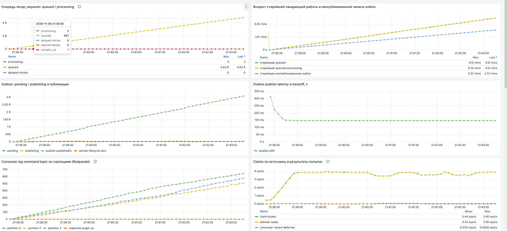
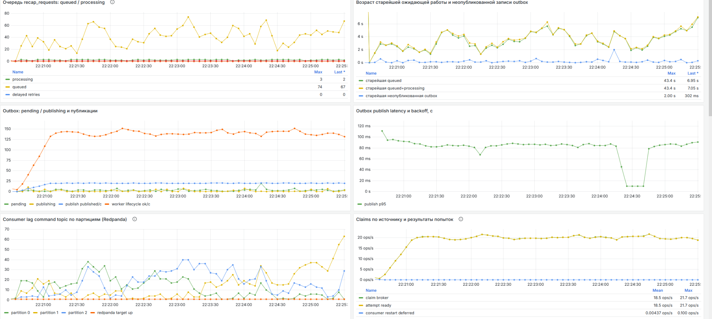

# Как задержка публикации в Redpanda влияла на время готовности recap

При нагрузке 20 POST/с API быстро принимал задания, но три worker не успевали их завершать. За пять минут очередь выросла примерно до 4830 заданий. После снижения `pandaproxy_client.produce_batch_delay_ms` со 100 до 5 мс к концу подачи в очереди осталось 67 заданий. Стенд прошёл все проверки сценария `steady`.

## Условия эксперимента

Два последовательных прогона на одном стенде (Ryzen 7 5700X, 32 ГБ RAM, Windows 10 / WSL, Docker Compose). В Redpanda v26.2.2 меняли один параметр. Для обоих значений совпали настройка в YAML и значение в логе запущенного брокера.

- Три worker, три партиции топика команд, получение заданий из брокера. Narrative строился по шаблону с отключённым Mistral.
- Перед каждым прогоном пересоздавались bench-volumes. Один seed (`20261110`) задавал 7260 профилей по 50 событий. Перед измерением скрипт проверял пустые очереди, доступность брокера, три активных consumer и свежие метрики.
- k6 подавал 20 основных POST/с. Прогрев длился 60 с, измерение — 300 с. Во время измерения отдельный пользовательский сценарий каждые 5 с планировал ещё один POST и опрашивал статус до готовности или таймаута.

## Результаты фазы измерения

| Метрика | A · 100 мс | B · 5 мс |
|---|---:|---:|
| POST, принятые с HTTP 202 | 6041 | 6060 |
| Пропущенные итерации k6 | 20 | 0 |
| p95 ответа HTTP 202 | 8 мс | 12 мс |
| Время одной HTTP-публикации команды из outbox, среднее по панели | 103 мс | 13,9 мс |
| Запись результата публикации в PostgreSQL, среднее по панели | 3,25 мс | 4,62 мс |
| Суммарное время семи lifecycle-публикаций на успешную попытку, среднее по панели | 778 мс | 77,4 мс |
| Скорость завершения заданий, среднее по панели | 3,43/с | 18,5/с |
| Задания в статусе queued в конце подачи | ≈4830 | 67 |
| p95 ожидания ready среди клиентов, дождавшихся результата | 150,08 с | 5,07 с |
| Незавершённые задания к дедлайну drain (10 минут) | 1952 | 0 |
| Вердикт | FAILED | PASSED |

Средние по панелям Grafana взяты за пятиминутные окна подачи, включая разгон. На установившемся участке B скорость завершения держалась около 20 заданий/с. Перцентили HTTP и пользовательского ожидания взяты из итогов k6. Варианты различались числом стартовавших пользовательских итераций, а таймауты не входили в выборку времени до ready.

## Где возникала задержка

Путь команды проходил через PostgreSQL outbox и Redpanda HTTP Proxy. В A outbox публиковал на плато около 9,6 команды/с при входящих 20 POST/с. После публикации оставалось второе ожидание: worker синхронно отправлял семь lifecycle-событий на успешное задание. К концу подачи росли и число неопубликованных команд, и lag всех трёх партиций.

В B worker сохранил те же семь публикаций, но в среднем они занимали примерно на 0,70 с меньше на задание. Время записи результата в PostgreSQL слегка выросло. Ускорение наблюдалось на HTTP-публикациях как у outbox, так и у worker. Отношение средних скоростей завершения составило **5,4×** в этой паре прогонов. Максимальную пропускную способность и длительную устойчивость стенда эксперимент не измерял.

## Burst при задержке 5 мс

На том же стенде после варианта B выполнили один прогон с тремя workers. Брокер подтвердил 5 мс. Run ID `20261109T224127Z-burst`, Git SHA `132ed28f2a2c07e7d032a4625a3e2cafaadb613f`, seed `1794264087`. Временные границы и результаты относятся к 9 ноября 2026 года (UTC).

| Фаза | Длительность | Фактическая подача | Принято с HTTP 202 | p95 приёма POST | p95 от создания до ready по PostgreSQL |
|---|---:|---:|---:|---:|---:|
| До пика | 120 с | 10 POST/с | 1200 | 11 мс | 3,048 с |
| Пик | 10 с | 100 POST/с | 1000 | 14 мс | 34,008 с |
| После пика | 180 с | 10 POST/с | 1800 | 12 мс | 29,401 с |

Все 4000 запросов получили HTTP 202. Сверка с PostgreSQL подтвердила 4000 уникальных готовых заданий с валидным snapshot. Ошибок POST, пропусков генератора, повторных попыток обработки и пропавших ID — 0.

**Где ждали задания.** Для запросов, созданных в пике, p95 ожидания первого claim составил 33,909 с, p95 полного времени до ready — 34,008 с. Эти распределения указывают на ожидание в очереди как основной источник задержки. Backlog достиг 759 заданий при базовом диапазоне 6–27. Максимальный наблюдаемый возраст старейшего задания составил 37,529 с, старейшей неопубликованной записи outbox — 0,599 с. Метрики очереди снимались с шагом 5 с.

**Вердикт burst — FAILED по восстановлению.** В течение 180 с после пика при фоновых 10 POST/с стенд должен был одновременно удерживать backlog ≤ 27 и возраст старейшего задания ≤ 3,3 с в течение 30 с подряд. Проверка не зафиксировала такого интервала. После полной остановки подачи проверка drain зафиксировала готовность всех заданий через 11,8 с. Нагрузка, корректность, измеритель, конфигурация и заданные пороги производительности прошли проверку.

## Графики и артефакты

**A · 100 мс.** Очередь растёт до конца подачи. Run ID `20261109T213049Z-steady`, окно 9 ноября 2026, 21:38:18–21:43:18 UTC.

**B · 5 мс.** Очередь колеблется в пределах 74 заданий за окно измерения. Run ID `20261109T221732Z-steady`, окно 9 ноября 2026, 22:20:31–22:25:31 UTC.

На стенде результаты каждого запуска находятся в `bench/results/<run-id>/`: `summary.md` содержит проверки, `reconcile-measure.json` — сверку принятых заданий с PostgreSQL, `host/redpanda-config.json` — подтверждение настройки брокера.
